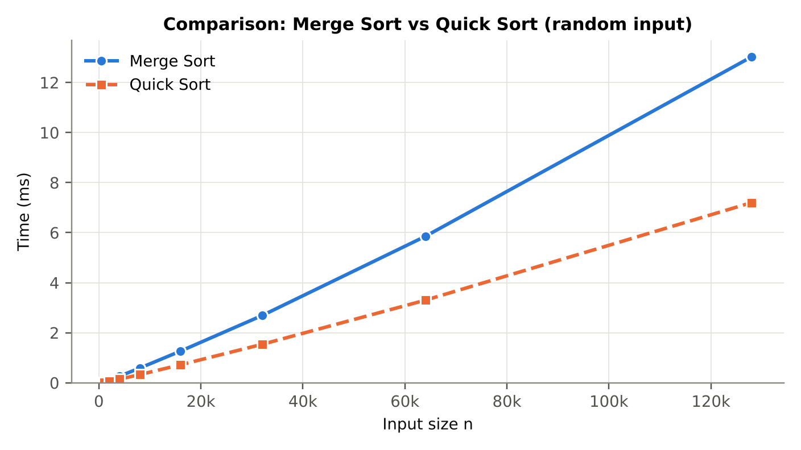
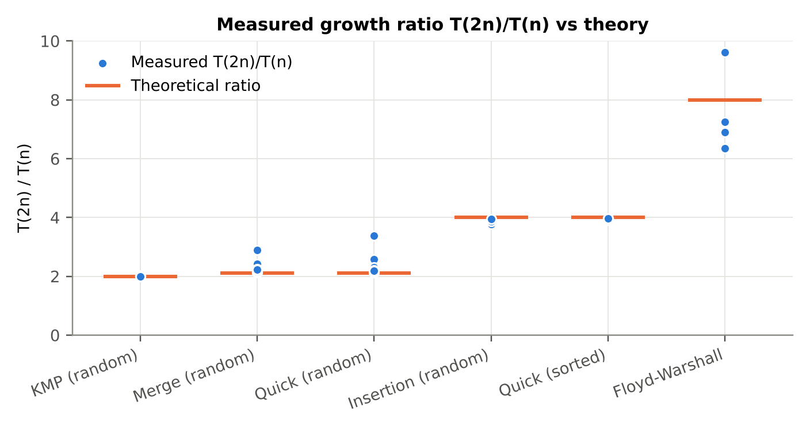

# DAA Assignment 3: Implementation and Experimental Analysis of Algorithms

**Course:** Design and Analysis of Algorithms (CIC-311), MAIT Delhi  
**Student:** Garv Nanda (03614802724), Section 5C2

Five algorithms from three syllabus groups are implemented in basic C++. Each one is timed on inputs of increasing size, and the measured growth is compared with the theoretical time complexity using the ratio T(2n)/T(n).

| # | Algorithm | Group | Complexity |
|---|---|---|---|
| 1 | Insertion Sort | Sorting | O(n²), best O(n) |
| 2 | Merge Sort | Sorting (Divide & Conquer) | O(n log n) |
| 3 | Quick Sort (last-element pivot) | Sorting (Divide & Conquer) | O(n log n), worst O(n²) |
| 4 | Floyd-Warshall | Dynamic Programming | Θ(V³) |
| 5 | Knuth-Morris-Pratt | String Matching | O(n + m) |

## Files

| File | Purpose |
|---|---|
| `insertion_sort.cpp`, `merge_sort.cpp`, `quick_sort.cpp` | Sorting algorithms: correctness check + timing |
| `floyd_warshall.cpp` | All-pairs shortest paths (checked against Bellman-Ford) |
| `kmp.cpp` | KMP string matching (checked against `std::string::find`) |
| `sort_crossover.cpp` | Insertion vs Merge vs Quick on small inputs (n = 4 ... 512) |
| `run_all.bat` | Compiles and runs everything on Windows, writes `output_log.txt` |
| `plot_results.py` | Draws all graphs from the CSV files (Matplotlib) |
| `results_*.csv`, `output_log.txt` | Measured times used in the report |
| `graphs/` | All figures |

## How to run

Requires a C++ compiler (`g++`). Tested with MinGW g++ (GCC 6.3.0) on Windows 11, edited in VS Code.

```
g++ -O2 -std=c++17 merge_sort.cpp -o merge_sort.exe
merge_sort.exe
```

Or just double-click `run_all.bat` to compile and run all programs.

Graphs: `pip install matplotlib`, then `python plot_results.py . graphs`

## Method

- Fixed-seed random generator, so every run uses the same input on every machine
- Only the algorithm call is timed (`std::chrono::steady_clock`), on a fresh copy of the input
- 3 runs per input size, and the average is reported. Runs shorter than 50 ms are repeated inside the run and averaged
- Correctness check before timing (all passed)

## Results (Intel Core i5-11260H, Windows 11, `-O2`)

| Algorithm | Input | Complexity | Expected T(2n)/T(n) | Measured mean |
|---|---|---|---|---|
| Insertion Sort | random | O(n²) | ≈ 4 | 3.85 |
| Insertion Sort | sorted (best) | O(n) | ≈ 2 | 1.91 |
| Insertion Sort | reverse (worst) | O(n²) | ≈ 4 | 3.85 |
| Merge Sort | random | O(n log n) | ≈ 2.1 | 2.32 |
| Quick Sort | random | O(n log n) | ≈ 2.1 | 2.42 |
| Quick Sort | sorted (worst) | O(n²) | ≈ 4 | 3.95 |
| Floyd-Warshall | dense graph | Θ(V³) | ≈ 8 | 7.29 |
| KMP | random text | O(n + m) | ≈ 2 | 2.01 |
| KMP | aaa...a text | O(n + m) | ≈ 2 | 2.02 |



